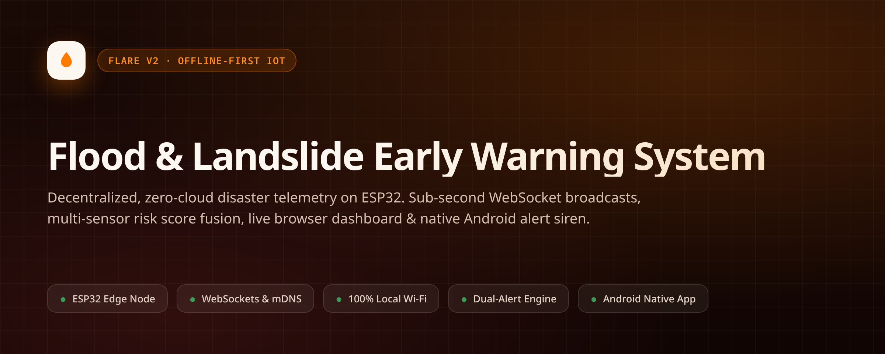
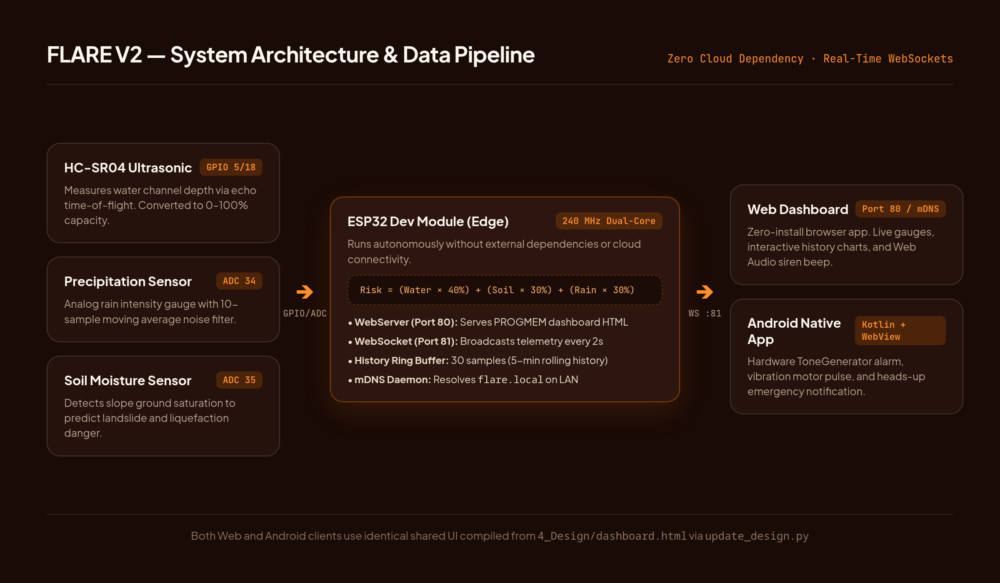
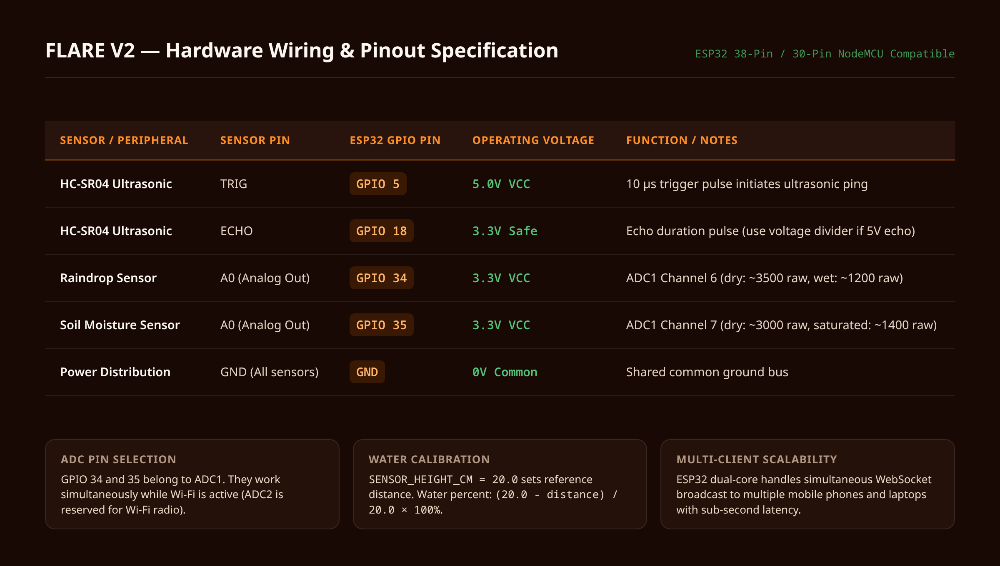
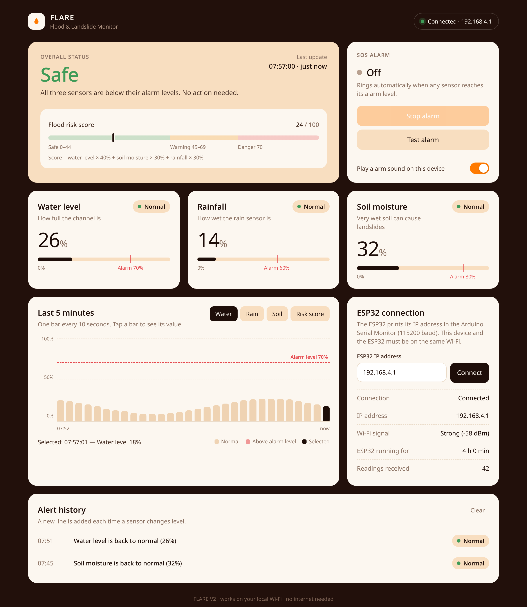
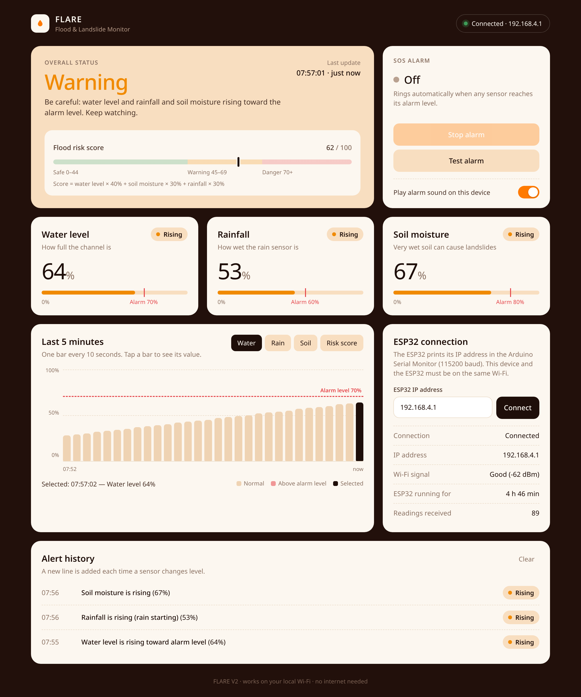
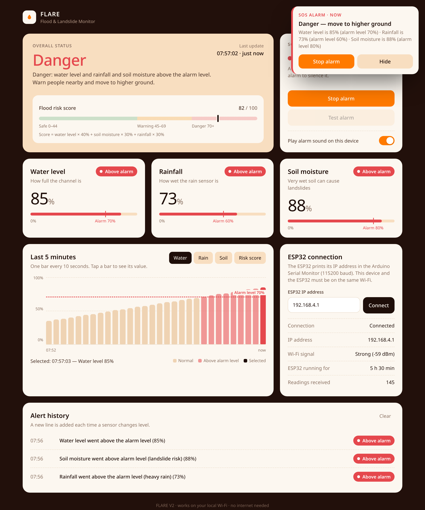
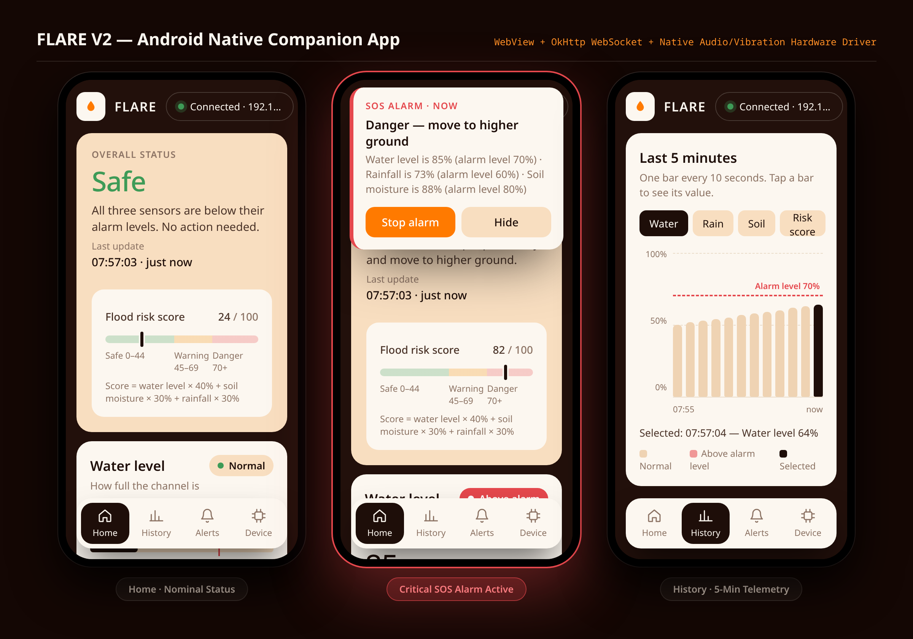

<div align="center">



# FLARE V2 — Flood & Landslide Alert & Real-Time Evaluation

**Decentralized, zero-cloud disaster telemetry & early warning system powered by ESP32 edge computing.**  
*Sub-second WebSocket broadcasts · Multi-sensor risk scoring · Instant web dashboard · Native Android companion with hardware sirens.*

---

[](https://www.espressif.com/en/products/socs/esp32)
[](1_ESP32_Code/FLARE_V2_ESP32/FLARE_V2_ESP32.ino)
[](3_Android_App)
[](#-api--telemetry-protocol)
[](#-the-philosophy-why-v2)
[](LICENSE)

</div>

---

## Table of Contents

- [The Philosophy: Why V2?](#-the-philosophy-why-v2)
- [Key Features](#-key-features)
- [System Architecture](#-system-architecture)
- [Hardware & Wiring Specification](#-hardware--wiring-specification)
- [Risk Scoring & Mathematical Models](#-risk-scoring--mathematical-models)
- [Dashboard & Visual Showcase](#-dashboard--visual-showcase)
- [Android Companion App](#-android-companion-app)
- [Getting Started](#-getting-started)
  - [1. ESP32 Firmware Setup](#1-esp32-firmware-setup)
  - [2. Laptop / Desktop Web Dashboard](#2-laptop--desktop-web-dashboard)
  - [3. Android App Installation](#3-android-app-installation)
- [Design Synchronization System](#-design-synchronization-system)
- [API & Telemetry Protocol](#-api--telemetry-protocol)
- [Repository Structure](#-repository-structure)
- [Troubleshooting & Diagnostics](#-troubleshooting--diagnostics)
- [License & Contributing](#-license--contributing)

---

## The Philosophy: Why V2?

When extreme climate events, flash floods, and hill-slope landslides strike, **commercial cellular infrastructure, cloud backhauls, and external APIs are frequently the first points of failure**.

Traditional IoT disaster solutions rely on third-party cloud platforms (such as Blynk, AWS IoT, or Firebase). If the local cell tower loses power or the internet backhaul gets cut, cloud-dependent alarms go silent—leaving downstream communities vulnerable.

**FLARE V2 was re-architected with an uncompromising offline-first philosophy:**
- **Zero Cloud Dependence:** The ESP32 edge node hosts its own web server, broadcast engine, and rolling telemetry buffer.
- **Local Wi-Fi / Hotspot Resilience:** Runs continuously over any local Wi-Fi router, emergency battery-powered portable access point, or smartphone hotspot.
- **Sub-Second Broadcasts:** Direct bidirectional WebSockets (Port 81) push sensor telemetry to all connected phones and computers every 2 seconds without external latency.
- **Decoupled Companion App:** Native Android application connects over socket directly to the ESP32 IP, providing continuous background monitoring, hardware vibration pulses, and full-volume alarm sirens.

---

## Key Features

| Capability | Technical Detail |
|---|---|
| **Multi-Sensor Fusion** | Real-time fusion of ultrasonic water channel height, precipitation rate, and soil moisture saturation. |
| **Edge Risk Score Engine** | Dynamic weighted risk calculation (`Water × 40% + Soil × 30% + Rain × 30%`) yielding a nominal 0–100 index. |
| **High-Performance WebSockets** | Port 81 persistent connection broadcasting JSON telemetry frames to unlimited concurrent LAN clients. |
| **Rolling 5-Min Telemetry Buffer** | In-memory 30-sample circular ring buffer on the ESP32 transmitting historical trend curves instantly upon client handshake. |
| **Single-Source Design Engine** | `4_Design/dashboard.html` compiles directly to standalone web, Android assets, and ESP32 C++ `PROGMEM` headers. |
| **Zero-Install Web Dashboard** | Responsive web interface served directly from the micro-controller at `http://flare.local` or direct IP. |
| **Emergency Acoustic Sirens** | Dual alarm engine: in-browser Web Audio API synthesized siren (880 Hz / 660 Hz) + Android OS `ToneGenerator` (STREAM_ALARM). |
| **High-Priority Android Heads-Up** | Ongoing alert notification with interactive "Stop alarm" actions and emergency wakelocks. |

---

## System Architecture

<div align="center">
  
</div>

### Architectural Layers
1. **Perception Layer (Hardware):** Physical transducers capturing water level distance (time-of-flight), rainfall contact resistance, and slope soil moisture.
2. **Edge Processing Node (ESP32):** Dual-core 240 MHz microcontroller performing analog-to-digital conversion, 10-sample moving average filtering, mathematical risk score synthesis, threshold comparison, and serial telemetry logging.
3. **Transport & Network Layer:** Local 802.11 b/g/n Wi-Fi stack running mDNS (`flare.local`), HTTP WebServer on Port 80, and WebSockets on Port 81.
4. **Client Presentation Layer:**
   - **Embedded / Desktop Web Client:** Single-page dashboard rendering real-time status indicators, history histograms, and local Web Audio alerts.
   - **Mobile Android Client:** Kotlin + Android WebView bridge with OkHttp WebSocket, system notification channels, and hardware vibrator drivers.

---

## Hardware & Wiring Specification

<div align="center">
  
</div>

### Pin Connection Matrix

| Peripheral Component | Module Pin | ESP32 GPIO | Logic Voltage | Functional Description |
|---|---|---|---|---|
| **HC-SR04 Ultrasonic** | `VCC` | `5V` (VIN) | 5.0V | Ultrasonic transducer power rail |
| **HC-SR04 Ultrasonic** | `GND` | `GND` | Common Ground | System ground return |
| **HC-SR04 Ultrasonic** | `TRIG` | `GPIO 5` | 3.3V Output | 10 µs trigger pulse to initiate ultrasonic sound burst |
| **HC-SR04 Ultrasonic** | `ECHO` | `GPIO 18` | 3.3V Safe Input | High pulse proportional to obstacle distance (voltage divider recommended) |
| **Raindrop Sensor** | `A0` | `GPIO 34` | 3.3V Analog Input | ADC1 Channel 6 (dry: ~3500 raw, saturated: ~1200 raw) |
| **Raindrop Sensor** | `VCC` / `GND` | `3.3V` / `GND` | 3.3V Power | Sensor bias power |
| **Soil Moisture Sensor** | `A0` | `GPIO 35` | 3.3V Analog Input | ADC1 Channel 7 (dry: ~3000 raw, saturated: ~1400 raw) |
| **Soil Moisture Sensor** | `VCC` / `GND` | `3.3V` / `GND` | 3.3V Power | Sensor excitation rail |

> **Crucial Hardware Note:** GPIO 34 and GPIO 35 belong to **ADC1**. They remain fully operational while the Wi-Fi radio is actively transmitting (unlike ADC2 channels, which are locked out during active Wi-Fi).

---

## Risk Scoring & Mathematical Models

### 1. Water Channel Depth Calculation
The HC-SR04 sensor measures ultrasonic flight duration. Distance in centimeters is calculated using the speed of sound ($343\text{ m/s}$):
$$\text{Distance (cm)} = \frac{\text{Duration (\mu s)} \times 0.0343}{2}$$

Given a baseline mounting height $H_{\text{sensor}} = 20.0\text{ cm}$:
$$\text{Water Level (\%)} = \left(\frac{H_{\text{sensor}} - \text{Distance}}{H_{\text{sensor}}}\right) \times 100$$
Constrained to range $[0, 100]\%$.

### 2. Analog Sensor Mapping (Moving Average)
To eliminate raw electrical noise from fluctuating water droplets and ground currents, 10 consecutive readings are averaged with a $5\text{ ms}$ interval:
$$\bar{A} = \frac{1}{10} \sum_{i=1}^{10} \text{AnalogRead}(\text{pin})$$

Linear percentage calibration:
$$\text{Sensor Level (\%)} = \frac{\bar{A} - \text{Raw}_{\text{dry}}}{\text{Raw}_{\text{wet}} - \text{Raw}_{\text{dry}}} \times 100$$

### 3. Composite Flood & Landslide Risk Index
FLARE combines hydrological and geological threat indicators using an empirically weighted danger model:
$$\text{Risk Score} = (0.40 \times \text{Water\%}) + (0.30 \times \text{Soil\%}) + (0.30 \times \text{Rain\%})$$

| Risk Score | Threat Level | Visual Indicator | Triggered System Action |
|---|---|---|---|
| **0 – 44** | **Safe / Nominal** | Green (`#3E9B57`) | Continuous background polling; normal telemetry logging. |
| **45 – 69** | **Warning / Elevated** | Amber (`#F08A00`) | Caution state; operators notified of rising water/saturation. |
| **70 – 100** | **Critical Danger (SOS)** | Crimson (`#E5484D`) | Immediate SOS siren activation, heads-up mobile notification, evacuation alert. |

---

## Dashboard & Visual Showcase

The FLARE V2 user interface is crafted using warm disaster typography and semantic color tokens (`#22100B` ink, `#FCF7F0` cream, `#FF7A00` alert orange).

### 1. Safe / Nominal Monitoring State
All sensors operating well below danger thresholds. Real-time RSSI signal strength (`-58 dBm`), uptime, and active telemetry logs are displayed.
<div align="center">
  
</div>

### 2. Elevated Warning State
Precipitation and soil moisture rising toward the alarm limits. The dashboard visualizes dynamic threshold markers and alerts operators to heightened risk.
<div align="center">
  
</div>

### 3. Critical Danger (SOS Emergency Alarm)
Water level exceeds $70\%$ or soil saturation exceeds $80\%$. The high-contrast SOS emergency modal triggers automatically, activating browser siren beeps and logging critical events.
<div align="center">
  
</div>

---

## Android Companion App

The native Android app (`3_Android_App`) bridges native hardware capabilities with the shared responsive dashboard UI.

<div align="center">
  
</div>

### Android Capabilities
- **Background WebSocket Heartbeat:** Uses OkHttp to maintain an active socket connection with automatic reconnect backoff.
- **Hardware Emergency Siren:** Invokes `ToneGenerator(AudioManager.STREAM_ALARM, 80)` to sound alerts even when media audio is muted.
- **Tactile Vibration Motor:** Pulses the system vibrator using modern `VibratorManager` (Android 12+) and backwards-compatible APIs.
- **Actionable Heads-Up Notifications:** High-importance alert channel with interactive "Stop alarm" direct intent to silence audio while keeping danger indicators active.

---

## Getting Started

### 1. ESP32 Firmware Setup

1. Open **Arduino IDE** (or VS Code + PlatformIO).
2. Go to **Tools → Manage Libraries...** and install:
   - `WebSockets` by Markus Sattler (v2.4.0+)
   - *(Built into ESP32 board core: `WiFi`, `WebServer`, `ESPmDNS`)*
3. Open `1_ESP32_Code/FLARE_V2_ESP32/FLARE_V2_ESP32.ino`.
4. Configure your Wi-Fi name and password at lines 29–30:
   ```cpp
   const char* WIFI_SSID = "YOUR_WIFI_OR_HOTSPOT_NAME";
   const char* WIFI_PASS = "YOUR_WIFI_PASSWORD";
   ```
5. Select Board: **ESP32 Dev Module**, Flash Frequency: **80MHz**, Upload Speed: **115200** (or 921600).
6. Flash firmware and open Serial Monitor at **115200 baud**. Note the assigned IP address:
   ```text
   ========================================
     Wi-Fi connected. ESP32 IP: 192.168.4.120
     Website : http://192.168.4.120
     Or      : http://flare.local
     App     : type the IP above, tap Connect
   ========================================
   ```

### 2. Laptop / Desktop Web Dashboard
1. Ensure your computer is connected to the same Wi-Fi / hotspot as the ESP32.
2. In Google Chrome or Firefox, navigate to:
   - `http://flare.local/` (via mDNS) or `http://<ESP32-IP>/`
3. Click once anywhere on the page to grant browser permission for Web Audio sirens.

### 3. Android App Installation

#### Option A: Direct APK Install (Recommended)
1. Download `FLARE_V2.apk` from the [Latest GitHub Release](../../releases/latest).
2. Transfer to your Android phone via USB, Drive, or local share.
3. Tap the file and approve "Install from Unknown Sources".
4. Open the app, enter the ESP32 IP address, and tap **Connect**.

#### Option B: Build from Source
From the project root on Windows, run:
```bat
BUILD_APK.bat
```
Or on Linux / macOS inside `3_Android_App/`:
```bash
./gradlew assembleDebug
```
The compiled binary lands at `3_Android_App/app/build/outputs/apk/debug/app-debug.apk`.

---

## Design Synchronization System

FLARE V2 uses a **single source of truth** architecture for its user interface. You never need to write UI code three times.

```
                  4_Design/dashboard.html
                             │
            ┌────────────────┼────────────────┐
            ▼                ▼                ▼
       2_Website/       3_Android_App/   1_ESP32_Code/
    FLARE_Dashboard.html (WebView Asset) dashboard_html.h (PROGMEM)
```

To update colors, typography, or UI layouts:
1. Edit `4_Design/dashboard.html`.
2. Run the sync script:
   ```bash
   python3 4_Design/update_design.py
   ```
3. The script synchronizes the standalone website, the Android app assets, and compiles the raw HTML into the C++ PROGMEM string literal in `dashboard_html.h`.
4. Re-upload ESP32 sketch and rebuild Android APK.

---

## API & Telemetry Protocol

The ESP32 exposes both HTTP REST endpoints and a high-frequency WebSocket stream.

### 1. HTTP Endpoints

#### `GET /api/data`
Returns latest real-time sensor snapshot.
```json
{
  "t": "live",
  "water": 45,
  "rain": 12,
  "soil": 38,
  "risk": 33,
  "h": 0,
  "lim": [70, 60, 80],
  "rssi": -62,
  "up": 3420,
  "ip": "192.168.4.120",
  "cl": 2
}
```

#### `GET /api/history`
Returns the 30-sample rolling 5-minute telemetry buffer:
```json
{
  "t": "history",
  "items": [
    [22, 10, 30, 21, 290],
    [24, 11, 31, 23, 280],
    [28, 14, 32, 26, 10]
  ]
}
```
*Each tuple: `[water_pct, rain_pct, soil_pct, risk_pct, age_in_seconds]`.*

### 2. WebSocket Protocol (`ws://<ESP32-IP>:81/`)

- **On Client Connected:** ESP32 immediately transmits full history array `{"t":"history", "items":[...]}` followed by the live state snapshot.
- **Every 2 Seconds:** ESP32 broadcasts a `{"t":"live", ...}` packet to all connected clients.
- **Client Heartbeat:** OkHttp and web browser maintain ping/pong keepalive frames.

---

## Repository Structure

```text
FLARE_V2/
├── .github/
│   ├── ISSUE_TEMPLATE/
│   │   ├── bug_report.md          # Standard bug report template
│   │   └── feature_request.md     # Feature proposal template
│   └── PULL_REQUEST_TEMPLATE.md   # PR verification checklist
├── 1_ESP32_Code/
│   └── FLARE_V2_ESP32/
│       ├── FLARE_V2_ESP32.ino     # Core C++ Arduino firmware (Sensors, WebSockets, HTTP)
│       └── dashboard_html.h       # PROGMEM compiled dashboard asset (auto-generated)
├── 2_Website/
│   └── FLARE_Dashboard.html       # Standalone laptop dashboard (open locally or on server)
├── 3_Android_App/                 # Complete native Android Studio Kotlin project
│   ├── app/src/main/
│   │   ├── java/com/flare/mobile/MainActivity.kt  # OkHttp WebSocket, Siren & Notifications
│   │   ├── assets/dashboard.html  # Embedded webview dashboard
│   │   └── AndroidManifest.xml    # Permissions, hardware features, notification channels
│   └── build.gradle.kts           # Gradle configuration (compileSdk 37, minSdk 26)
├── 4_Design/
│   ├── dashboard.html             # MASTER UI TEMPLATE (Single source of truth)
│   └── update_design.py           # Automated build script compiling UI to Web, App & ESP32
├── docs/
│   └── images/                    # High-resolution retina diagrams and screenshots
│       ├── hero-banner.png
│       ├── dashboard-safe.png
│       ├── dashboard-warning.png
│       ├── dashboard-danger.png
│       ├── mobile-showcase.png
│       ├── system-architecture.png
│       └── hardware-pinout.png
├── scripts/
│   └── generate_assets.py         # Headless browser rendering script for visual assets
├── BUILD_APK.bat                  # One-click Windows batch script to compile Android APK
├── .gitignore                     # Git ignore rules for build artifacts & IDE files
├── CONTRIBUTING.md                # Contributor guidelines & workflow
├── LICENSE                        # MIT Open Source License
└── README.md                      # Complete project documentation
```

---

## Troubleshooting & Diagnostics

| Symptom | Probable Cause | Corrective Action |
|---|---|---|
| **Android App says "Offline · retrying"** | Phone and ESP32 are not on the same subnet. | Verify both devices are connected to the exact same Wi-Fi router or hotspot. Confirm the entered IP address. |
| **`flare.local` fails to resolve** | mDNS is not supported by your network or Windows client. | Use direct IP address printed in the Arduino Serial Monitor (e.g. `http://192.168.4.xxx`). |
| **Water Level displays `--%`** | Ultrasonic echo pulse timed out or out of range. | Check wiring on GPIO 5 (TRIG) and GPIO 18 (ECHO). Ensure target surface is within $2\text{ cm} \le d \le 20\text{ cm}$. |
| **Web audio alarm does not sound** | Modern browsers block audio autoplay until user interaction. | Click or tap anywhere on the dashboard once after loading the page to unlock the Web Audio Context. |
| **ESP32 restarts every 30 seconds** | Wi-Fi failed to connect. | Check `WIFI_SSID` and `WIFI_PASS` spelling. Ensure the router supports 2.4 GHz (ESP32 does not support 5 GHz Wi-Fi). |

---

## License & Contributing

This project is licensed under the **MIT License** — see the [LICENSE](LICENSE) file for complete details.

Contributions, feature requests, and field test reports from flood-prone regions are warmly welcomed! Please review the [Contributing Guide](CONTRIBUTING.md) and submit pull requests to help improve disaster resilience worldwide.

---

<div align="center">
  <b>Built for disaster resilience, community safety, and offline-first edge computing.</b>
</div>
